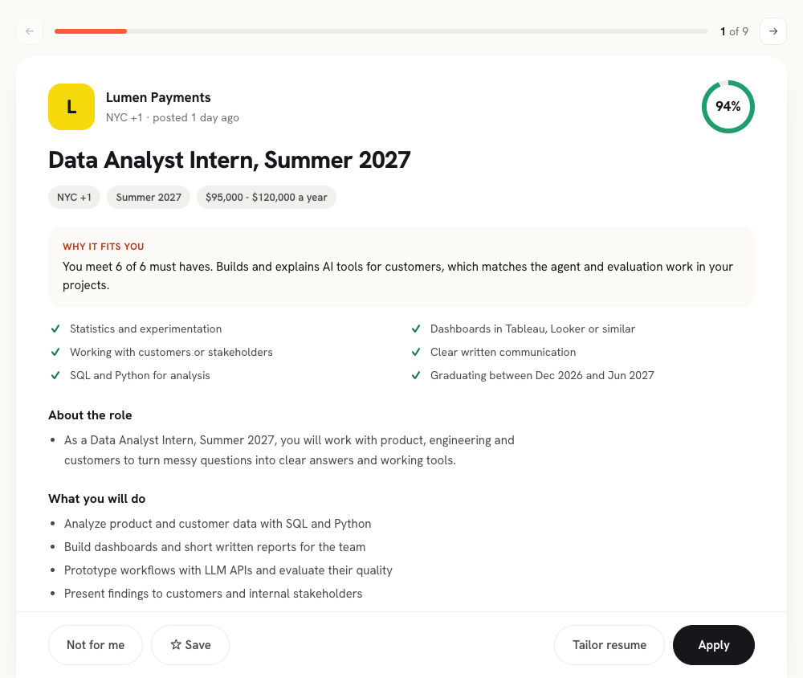
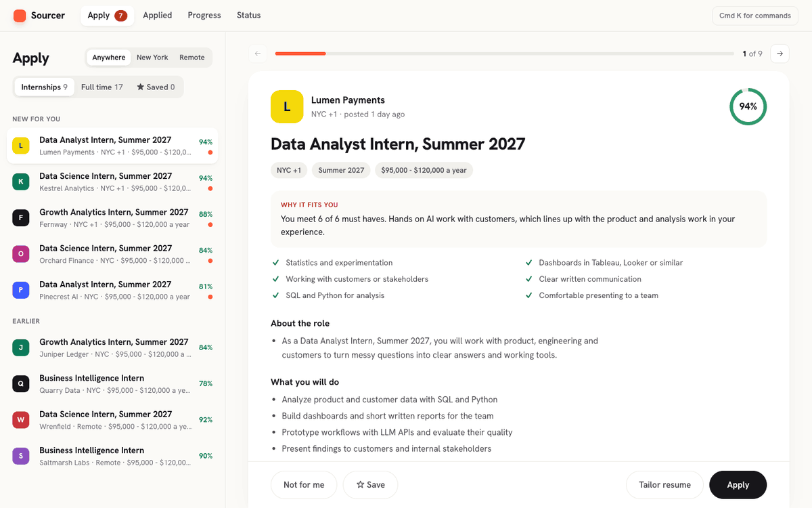

# Sourcer

Sourcer finds early career roles worth applying to: it reads thousands of
company job boards every morning, sets aside what cannot fit with plain rules,
and has Claude judge the rest against the candidate's own work history.



[](https://github.com/marinasofia/sourcer/actions/workflows/ci.yml)
[](pyproject.toml)
[](pyproject.toml)
[](pyproject.toml)
[](LICENSE)



These screens come from the private app that runs on this engine, filled with
made up companies, roles and run numbers for the screenshots. The app and real
search data stay in a private repository.

## Results

From the morning run on October 20, 2026, recorded in the private run log:

| | |
|---|---|
| Job boards read | 615 |
| Postings read | 48,031 |
| Set aside by rules, before any model call | 45,806 (95%) |
| New roles judged by the model | 150 |

The score scale was calibrated on 85 labelled postings from that private run
data (23 wanted): a score of 75 keeps 80% of the wanted roles at 65% precision,
and 85 reaches 85% precision. The anchor points are in `calibrate()` in
`sourcer/llm.py`. The 19 public cases in `evals/` replay the deterministic
rules in CI (`python -m sourcer.evaluate`).

## How it works

- **Collect.** New companies come from YC, Built In NYC, Hacker News "Who is
  hiring", SimplifyJobs and VC portfolio boards. Postings are read from 9 job
  board APIs (Greenhouse, Lever, Ashby, Workable, SmartRecruiters, Rippling,
  Workday, Eightfold, Oracle) and a sandboxed headless browser for script only
  careers pages.
- **Rules before the model.** Location, seniority, years required, start dates
  and explicit work authorization limits are checked in code. When a rule acts
  on the posting's own words, such as "5+ years", those words are stored with
  the decision, so every dropped role can be explained.
- **The model answers checks; code computes the score.** A small model copies
  the posting's facts with quotes, then the scoring model answers fixed yes or
  no checks against the candidate's approved evidence. Arithmetic in code
  turns the answers into a 0 to 100 score, which keeps scores auditable and
  stable between runs.
- **Rank and learn.** Freshness, deadlines and the score order the list. A role
  still on its board is never dropped for its age, and thumbs up or down move
  a role by at most five points without overriding a rule.
- **Everything from outside is untrusted.** Every fetched URL goes through one
  guard (public HTTPS only, redirects checked, connection pinned, replies
  capped) and posting text is fenced as data in every prompt. See
  [SECURITY.md](SECURITY.md).

## Tech stack

Python, LangGraph, the Claude API (or the Claude Code CLI), Playwright, SQLite
or Snowflake, an MCP server and an HTTP service for scoring a single posting.
It deploys to GitHub Actions, Docker, AWS Lambda or Kubernetes. Every pull
request runs 1,100+ tests with a 90% coverage floor, mypy, Ruff, Bandit,
zizmor, CodeQL, dependency audits on hash pinned lockfiles and a secret scan
of the full history.

## Try it

Requires Python 3.12 or newer. This run needs no API key and makes no network
or model calls; it builds the database and prints an empty digest.

```bash
git clone https://github.com/marinasofia/sourcer.git
cd sourcer
python3 -m venv .venv
.venv/bin/python -m pip install -e .
cp skills_vector.example.json skills_vector.json
SOURCER_COMPANIES=tests/fixtures/companies-empty.json SOURCER_SIMPLIFY=0 SOURCER_COST_CAP=0 .venv/bin/python -m sourcer.main
```

For a live run, copy `profile.example.json` to `profile.json`, set
`ANTHROPIC_API_KEY` and run `.venv/bin/python -m sourcer.main --cost-cap 0.05`.
Live runs contact job boards and make paid model calls.

The location rules are written for a New York based candidate. `SOURCER_METROS`
(`nyc`, `sf`) picks the metros in scope; for another metro add its place names
to `METRO_TERMS` in `sourcer/config.py`, and change `NYC_RE` there if the
ranker should favour it.

## Use it for your own search

```bash
git clone https://github.com/marinasofia/sourcer.git && cd sourcer
python3 -m venv .venv && .venv/bin/pip install -e ".[onboard]"
.venv/bin/sourcer init
```

`sourcer init` asks for your resume first, then your GitHub username, then
offers project folders and links, and reads each one as you add it. It uses
your own Claude CLI login when `claude` is installed, otherwise your
`ANTHROPIC_API_KEY`. You approve each fact it finds (`sourcer facts review`),
and only approved facts are used for scoring. Then `sourcer` builds your list.
Skill weights are computed from those facts, each with its reason
(`sourcer skills`), and `sourcer sync` rechecks your sources and queues only
what changed.

Your data stays with you: it is kept in local files, and nothing goes to this
project. Only short redacted excerpts leave, to Anthropic through your own
Claude login or key, plus GitHub's public API for your username and the
links you add.
`sourcer forget` removes one source or everything; see
[docs/privacy.md](docs/privacy.md).

## More

- [Reference](docs/reference.md): every setting, input file and command
- [Privacy](docs/privacy.md): what onboarding reads, sends and keeps
- [Operations](docs/operations.md): running, debugging, reading the run log
- [Deployment](docs/deployment.md): Docker, Actions, Lambda, Kubernetes, Snowflake
- [Model card](docs/model-card.md): how the model is used and where it fails
- [Design decisions](docs/adr/): the reasoning behind the architecture
- [Contributing](CONTRIBUTING.md) and [changelog](CHANGELOG.md)

Sourcer never fills in or submits an application. Personal data, results, and
credentials live in a separate private repository.

## License

[MIT](LICENSE)
