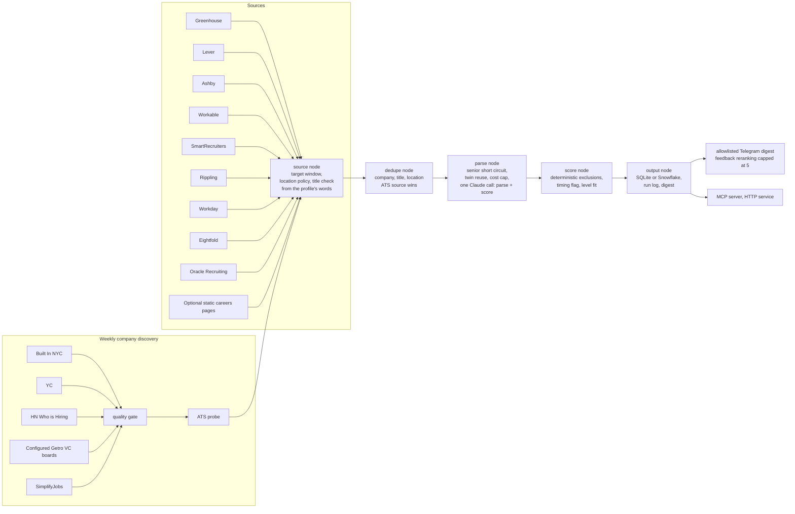

# Sourcer

Sourcer is a single-operator job discovery and matching system that
turns trusted company sources into fresh, filtered, scored opportunities.

[](https://github.com/marinasofia/sourcer/actions/workflows/ci.yml)
[](pyproject.toml)
[](pyproject.toml)
[](https://github.com/astral-sh/ruff)
[](pyproject.toml)
[](LICENSE)
[](CHANGELOG.md)

Most postings never reach the model. Freshness, location, target window,
seniority, company quality, deduplication, and score reuse run first. Personal
inputs, full results, Telegram credentials, and application materials stay in
the separate private data repository.

## Quickstart

Requires Python 3.12 or newer. This offline smoke run uses an empty company
list and disables external sources and model calls. It creates a local SQLite
database and prints an empty digest without an API key.

```bash
git clone https://github.com/marinasofia/sourcer.git
cd sourcer
python3 -m venv .venv
.venv/bin/python -m pip install -e .
cp skills_vector.example.json skills_vector.json
SOURCER_COMPANIES=tests/fixtures/companies-empty.json SOURCER_SIMPLIFY=0 SOURCER_COST_CAP=0 .venv/bin/python -m sourcer.main
```

For a live run, edit the skills weights, copy `profile.example.json` to
`profile.json` if needed, and set `ANTHROPIC_API_KEY` in your environment or
local `.env`. Then run `.venv/bin/python -m sourcer.main --cost-cap 0.05`.
Live runs contact external sources and can incur model charges. Cost estimates
depend on the model, retries, and workload; the configured budget is not a
provider billing limit. See [SECURITY.md](SECURITY.md) before deployment.

Commands here use POSIX shells. On Windows, use `.venv\Scripts\python.exe`
and set environment variables using your shell's syntax.

## Architecture



The discovery and matching flow:

1. **Discover.** Pulls companies from Built In NYC, YC, HN Who is Hiring,
   SimplifyJobs, and configured Getro VC networks. Companies need at least 20
   employees or recent verified backing. An ordered ATS probe records Ashby,
   Greenhouse, Lever, Workable, SmartRecruiters, Rippling, or a careers page.
   Collection also registers dedicated Workday, Eightfold, and Oracle Recruiting
   adapters for configured companies; registration is not a guarantee that every
   tenant or posting format works.
2. **Collect.** Reads structured ATS endpoints daily. An opt-in Playwright
   fallback is available for static careers pages. A role on a live ATS board is
   kept whatever its age, dated or not; age only lowers its rank. Simplify
   community listings retain the 21-day freshness gate. Location and
   early-career gates still apply, and every title goes through a title check
   that reads the profile's `target_work` and `avoid_work`, not a role list.
   Common explicit requirements above two years are rejected before AI triage.
3. **Dedupe.** Uses normalized company, title, and location. A direct ATS row
   replaces an aggregator row while keeping operator tracking fields.
4. **Parse.** Senior titles are excluded from the title alone. A posting with
   an already scored twin (same company and title) inherits its score. What
   remains goes to Claude Haiku in a single call that extracts structured
   fields and scores the match. Every reply is schema-validated with exactly
   one corrective retry.
5. **Score.** Deterministic exclusions with explicit signals only: senior
   title or mid/senior level, more than two years required, full time with immediate start,
   contract, hybrid or onsite outside NYC, full time starting before
   the candidate's availability. Ambiguous timing is flagged, never filtered. Level fit
   (fit, stretch, misfit) comes from the candidate profile.
6. **Notify and learn.** Writes postings and run metrics, sends an allowlisted
   Telegram digest, and accepts thumbs feedback. Feedback changes digest order
   by at most five points and never bypasses hard filters.

Design decisions with their reasoning live in [`docs/adr/`](docs/adr/). The
package layout (sources, pipeline, apply, bot) is described in
[`CLAUDE.md`](CLAUDE.md).

## Features

- Nine ATS adapters (including Workday, Eightfold, and Oracle Recruiting),
  weekly company discovery, and a read-only browser fallback.
- Estimated pipeline cost budget and token usage accounting.
- Prompt caching that switches itself on when the prefix is long enough.
- Backlog scoring through the Message Batches API at half price, with a
  dry-run cost preview.
- Source verification that archives dead links, including Workday.
- Application tracker statuses with GitHub issue alerts for strong matches.
- Default-on dry run and two Telegram allowlists, one for chats and one for users.
- Public-network URL validation for company probes and discovery requests.
- Deterministic daily and weekly orchestration with an overlap lock.
- SQLite by default, Snowflake behind a flag, same interface.
- MCP server, stdlib HTTP service with Kubernetes manifests, Lambda
  container with S3 state, Docker Compose.

See [upgrade instructions](docs/renaming.md) when moving an existing installation
to Sourcer.

## Configuration

Configuration is read once at import time. The project `.env` supplies defaults
before settings are evaluated; existing process environment variables win.
Set `SOURCER_ROOT` in the process environment to select a different input root.

The runtime `profile.json` can set `earliest_start_full_time` to a `YYYY-MM`
month. That explicit availability overrides the default month after graduation.
For example, `2028-05` allows May 2028 starts. Missing posting dates still need
manual review. Full-time postings need internship/entry-level wording, a junior
title, or a stated minimum of zero to two years. "Full-time" alone is not enough.
The text prefilter recognizes common numeric and written experience requirements;
optional qualifications are not mandatory, and unfamiliar wording still needs
review. Parsed experience above two years and mid/senior roles are hard exclusions.
A stricter `max_years_experience` in the profile still applies after parsing.

Before AI triage or scoring, collection also checks descriptions for common
explicit office attendance, relocation, or residency requirements outside NYC.
These override a misleading remote location label. Optional visits and explicit
NYC or remote alternatives remain eligible. This is a bounded text check:
unfamiliar wording or places still need review, and it does not replace the
location check after parsing. A zero-dollar run does not produce AI scores.

| Variable | Default | Purpose |
|---|---|---|
| `ANTHROPIC_API_KEY` | required | model calls |
| `SOURCER_MODEL` | `claude-haiku-4-5-20251001` | model id |
| `SOURCER_COST_CAP` | `2.50` | estimated pipeline budget in USD; not a provider billing limit |
| `SOURCER_DB` | `data/sourcer.db` | SQLite path |
| `SOURCER_ROOT` | the checkout | root for relative inputs and exports; set it for an installed package or a container |
| `SOURCER_BACKEND` | `sqlite` | `sqlite` or `snowflake` |
| `SOURCER_SKILLS` | `skills_vector.json` | weighted skills with synonyms |
| `SOURCER_COMPANIES` | `companies.json` | company list (name, ATS, slug) |
| `SOURCER_PROFILE` | `profile.json` | candidate profile for level fit and availability |
| `SOURCER_SIMPLIFY` | `1` | set `0` to skip the SimplifyJobs lists |
| `SOURCER_FRESHNESS_DAYS` | `30` | the one freshness window (`config.is_fresh`) and the age penalty threshold; a role its company's board still lists, or an undated one, is never dropped for age |
| `SOURCER_DRY_RUN` | `1` | disables Telegram network activity and state marking |
| `SOURCER_TELEGRAM_TOKEN` | empty | private Bot API token |
| `SOURCER_TELEGRAM_ALLOWED_CHAT_IDS` | empty | comma-separated destination allowlist |
| `SOURCER_TELEGRAM_ALLOWED_USER_IDS` | empty | comma-separated sender allowlist |
| `SOURCER_GETRO_API_KEY` | empty | optional Getro portfolio API token |
| `SOURCER_GETRO_NETWORKS` | `{}` | JSON map of supported VC names to network IDs |
| `SOURCER_DEGREE` | `Bachelor's` | degree filter for SimplifyJobs listings |
| `SOURCER_ALERT_SCORE` | `85` | alert threshold |
| `SOURCER_ALERT_CAP` | `60` | flood control for alert issues |
| `SOURCER_PRICE_IN`, `SOURCER_PRICE_OUT` | `1.00`, `5.00` | USD per million tokens for the cost estimate |
| `SOURCER_CACHE_MIN_TOKENS` | `4096` | model's minimum cacheable prefix |
| `SOURCER_LOG_LEVEL` | `INFO` | logging level for the package |
| `SOURCER_HTTP_HOST` | `127.0.0.1` | HTTP bind address; Kubernetes explicitly binds all container interfaces |
| `SOURCER_HTTP_PORT` | `8500` | HTTP scoring service port |
| `SOURCER_S3_BUCKET`, `SOURCER_SKIP_S3` | | Lambda state persistence |
| `SNOWFLAKE_ACCOUNT`, `SNOWFLAKE_USER`, `SNOWFLAKE_PASSWORD` | | Snowflake backend |

Input files:

- `companies.json`: the target company list.
- `skills_vector.json`: gitignored, personal. Copy the example and edit weights
  (1 to 10, relevance to your target roles, not proficiency).
- `profile.json`: optional. Copy `profile.example.json` to enable level fit
  and the graduation availability rule. Without it, every posting fits.

## Usage

Activate the quickstart environment with `source .venv/bin/activate` before
running these commands. Live scoring commands can make paid model requests.

```bash
sourcer --cost-cap 0.05                      # run the pipeline (same as python -m sourcer.main)
python -m sourcer.track list                 # ranked board with ids
python -m sourcer.track set 97 applied "sent 09-03"
python -m sourcer.score_listings --limit 30  # score unscored listings live
python -m sourcer.batch --dry-run            # price the backlog at batch rates
python -m sourcer.apply.verify --limit 600   # archive dead links
sourcer probe "Company Name"                 # discover and save its ATS board
sourcer probe --all                          # probe companies whose ATS type is empty
sourcer discover                             # weekly company discovery and bounded ATS probing
sourcer collect                              # daily structured collection and scoring
sourcer orchestrate daily                    # locked daily run plus Telegram digest
sourcer orchestrate weekly --probe-limit 25  # discovery, probe, collect, and weekly report
sourcer telegram                             # allowlisted URL intake and feedback bot
python -m sourcer.rescore                    # re-score after editing the vector
python -m sourcer.alerts                     # print or open the alert issue
python -m sourcer.mcp_server                 # MCP tools over stdio
python -m sourcer.serve                      # HTTP scoring service on :8500
```

Deployment on Docker, GitHub Actions, AWS Lambda, Kubernetes, and Snowflake is
covered in [`docs/deployment.md`](docs/deployment.md). Running, debugging, and
reading the run log are in [`docs/operations.md`](docs/operations.md).

## Code and data

This code repository is public and holds no operator data. A separate private
data repository holds the operator's skills vector, profile, scored results,
resumes, answer bank, Telegram secrets, and scheduled workflow. The scheduler
checks out this code repository at a pinned commit. It never pushes results
into the code repository. See [SECURITY.md](SECURITY.md).

The data repository pins an immutable code commit in its weekday workflow.
Promote only after verifying the candidate commit's CI and reviewing the workflow
change. The private `docs/last-success.json` records the actual deployed code SHA,
collection/export timestamp and Actions run URL. Its job summary is printed after
results are pushed. A pin or PR alone is not evidence of a successful live run.

Age is not a hard rejection for dated live-board roles. `config.age_penalty`
defines a bounded ranking penalty; the private iMessage selector applies it in
non-ML mode. The core pipeline keeps the stored model score unchanged.

## Development

```bash
.venv/bin/pip install -e ".[dev,aws,snowflake]"
.venv/bin/pre-commit install
.venv/bin/ruff check . && .venv/bin/ruff format --check .
.venv/bin/mypy
.venv/bin/pytest --cov
```

Tests use a fake Anthropic client and patched HTTP. No network, no key. The
coverage gate is 90% on the package, with line and branch coverage measured;
the latest local run exceeds the 90% gate. Import layering is itself a test. Full
guidance, including the style rules and the release process, is in
[CONTRIBUTING.md](CONTRIBUTING.md).

Free Python and workflow security scans run in GitHub alongside dependency and
privacy checks. See [security coverage](SECURITY.md#free-security-checks) and
[local scanner commands](docs/maintenance.md#security-scanner-verification).

How the model is used, what it is not for, and its known failure modes are
in the [model card](docs/model-card.md). The scoring policy is checked against
a labeled fixture in `tests/test_evaluate.py`; add a case there when a rule
changes. The standalone command uses the profile bundled with the labelled fixture.
An explicit `--profile` overrides it; bare record lists fall back to the configured
profile. See [CONTRIBUTING.md](CONTRIBUTING.md) for the reproducible command.

## Status and roadmap

Beta software for a trusted single operator. Company discovery, ATS collection,
quality and community freshness gates, an edge scorer measured on a gold set, bounded feedback learning,
Telegram controls, and
locked scheduling are implemented. Application submission remains disabled.

Recovery now preserves tracking fields for newly restored hashes. HTTP and MCP
share validation, exclusion, and model admission rules. See the
[boundary contracts](docs/boundary-contracts.md) for their limits.

TODO: complete transactional recovery, deployment controls, and release guarantees.
Branch protection is recommended but was not enabled at the September 4, 2026
audit. See [maintainer guidance](docs/maintenance.md),
[contribution guidelines](CONTRIBUTING.md), [Code of Conduct](CODE_OF_CONDUCT.md),
and [CHANGELOG.md](CHANGELOG.md).

## License

[MIT](LICENSE).

## Current activation status

The private scheduler runs structured collection on weekdays at 13:00 UTC and
company discovery on Mondays. Telegram remains offline in dry run until its
private token, one destination chat, and sender allowlist are configured. No
application is filled or submitted by this version.

Getro requires an authorized API key and network IDs. Generic careers-page
rendering is opt-in (`SOURCER_BROWSER=1`) and disables JavaScript. Workday,
Eightfold, and Oracle Recruiting have registered dedicated adapters;
Consider boards still need a dedicated adapter. These limits can
reduce recall; the proposed 3x increase has not been measured.

The source report is a seven-day posting cohort snapshot using current tracker
status, not a historical application event ledger. Feedback adjusts display
ranking by at most five points after three observations. It does not modify code,
prompts, credentials, hard filters, or the stored model score.

NousResearch Hermes is not installed or running. A future planner integration
must run in an isolated environment with no personal files or submission tools.

TODO: complete the gated integrations.
