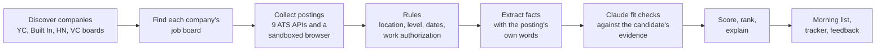

# Sourcer

Sourcer finds early career roles worth applying to. It reads company job boards
every morning, sets aside what cannot fit with plain rules and has Claude judge
the rest against the candidate's own work history, quoting the evidence for
every score.

[](https://github.com/marinasofia/sourcer/actions/workflows/ci.yml)
[](pyproject.toml)
[](pyproject.toml)
[](pyproject.toml)
[](LICENSE)

Sourcer is an ongoing project in active development. I use it every morning in
my own search and improve it almost every day, so the code and these numbers
keep changing. The [changelog](CHANGELOG.md) shows what moved recently.

What I learned: a score from a prompt drifts; asking the model fixed yes or no
checks with quotes and doing the arithmetic in code made scores auditable and
stable between runs.

## Why

Job boards answer "what is open", not "what should I apply to today". A
student searching by hand checks a few dozen companies, misses roles that
close in days and spends time on postings that quietly require three years of
experience or a citizenship the candidate does not have. Sourcer covers
thousands of companies and puts a short, explained list in front of the
candidate each morning.

## What a run looks like

From the morning run on October 20, 2026.

| | |
|---|---|
| Companies read | 615 boards, out of 3,004 companies tracked |
| Postings read | 48,031 |
| Set aside by rules, before any model call | 45,806 (95%) |
| New roles judged by the model | 150 |

These numbers come from my private run log; the public `companies.json` is a
23 company seed list and the full list of 3,004 companies lives in the private
data repository (see [ADR 0011](docs/adr/0011-public-code-repository.md)).

The rules that do most of that work are deterministic. When a rule acts on the
posting's own words, such as "5+ years" or "must be a US citizen", those words
are stored with the decision, so a dropped role can be explained.

## How it works



1. **Discover.** New companies come from YC, Built In NYC, Hacker News "Who is
   hiring", SimplifyJobs and VC portfolio boards. A probe finds which job board
   each one uses.
2. **Collect.** Greenhouse, Lever, Ashby, Workable, SmartRecruiters, Rippling,
   Workday, Eightfold and Oracle Recruiting are read through their APIs.
   Careers pages that only render with scripts are read in a sandboxed headless
   browser and one that links a known board is read through that board instead.
3. **Rules.** Location, seniority, years required, start dates, graduation
   windows and explicit work authorization limits. Unclear dates are flagged,
   never guessed.
4. **Extract, then judge.** Two model calls per posting. A small model first
   copies the posting's facts (start date, place, level, years required), each
   with the posting's own words; code keeps only the facts those words support
   and runs the rules on them. Only a posting that passes goes to the scoring
   model, which reads the candidate's approved facts from past jobs and
   projects and answers fixed checks. Is this the kind of work the candidate
   has done and is each real requirement covered, with a quote from the
   candidate's evidence? Code turns those answers into the score.
5. **Rank and learn.** Freshness, deadlines and the score order the list.
   Thumbs up or down move a role by at most five points and never override a
   rule.

## Decisions worth knowing

- **Rules before the model.** Most postings fail on facts a regex can read, so
  95% of them never cost a model call and the ones that do get a careful read.
- **The model answers checks; code computes the number.** A score from a
  prompt drifts and cannot be audited. Here the model says which requirements
  are covered and quotes where and fixed arithmetic makes the score. The
  scale was calibrated on 85 labelled postings from my private run data (23
  wanted). The 19 public cases in `evals/` exercise the deterministic rules in
  CI; `python -m sourcer.evaluate` replays them. A score of 75 keeps 80% of
  the wanted roles at 65% precision and 85 reaches 85% precision.
- **Never drop a live role for its age.** A role still on its company's board is
  still open. Age lowers its rank instead of removing it.
- **Feedback is bounded.** Preferences learned from thumbs adjust the order a
  little and never bypass a rule, so a few clicks cannot hide good roles.
- **Everything from outside is untrusted.** Every fetched URL goes through one
  guard. It allows public HTTPS only, checks each redirect, pins the connection
  to the address it checked and caps replies in size and time. Posting text is
  fenced as data in every prompt. These came out of a penetration test of the
  project before it was published; [SECURITY.md](SECURITY.md) has the details.

## Try it

Requires Python 3.12 or newer. This run needs no API key and makes no network
or model calls; it builds the database and prints an empty digest.

```bash
git clone https://github.com/marinasofia/sourcer.git
cd sourcer
python3 -m venv .venv
.venv/bin/python -m pip install -e .
cp skills_vector.example.json skills_vector.json
SOURCER_COMPANIES=tests/fixtures/companies-empty.json SOURCER_SIMPLIFY=0 SOURCER_COST_CAP=0 .venv/bin/python -m sourcer.main
```

For a live run, copy `profile.example.json` to `profile.json`, set
`ANTHROPIC_API_KEY` and run `.venv/bin/python -m sourcer.main --cost-cap 0.05`.
Live runs contact job boards and make paid model calls.

The location rules are written for a New York based candidate. `SOURCER_METROS`
(`nyc`, `sf`) picks the metros in scope; for another metro add its place names
to `METRO_TERMS` in `sourcer/config.py`, and change `NYC_RE` there if the
ranker should favour it.

## Use it for your own search

```bash
git clone https://github.com/marinasofia/sourcer.git && cd sourcer
python3 -m venv .venv && .venv/bin/pip install -e ".[onboard]"
.venv/bin/sourcer init
```

`sourcer init` asks for your resume first, then your GitHub username, then
offers project folders and links, and reads each one as you add it. It uses
your own Claude CLI login when `claude` is installed, otherwise your
`ANTHROPIC_API_KEY`. You approve each fact it finds (`sourcer facts review`),
and only approved facts are used for scoring. Then `sourcer` builds your list.

Your data stays with you: it is kept in local files, and nothing goes to this
project. Only short redacted excerpts leave, to Anthropic through your own
Claude login or key, plus GitHub's public API for your username.
`sourcer forget` removes one source or everything; see
[docs/privacy.md](docs/privacy.md).

## Built with

Python, LangGraph, the Claude API (or the Claude Code CLI), Playwright, SQLite
or Snowflake and an MCP server and HTTP service for scoring a single posting.
It deploys to GitHub Actions, Docker, AWS Lambda, or Kubernetes.

Every pull request runs 950+ tests with a 90% coverage floor,
mypy, Ruff, Bandit, zizmor for workflows, CodeQL, dependency audits on
hash pinned lockfiles and a secret scan of the full history.

## More

- [Reference](docs/reference.md): every setting, input file and command
- [Privacy](docs/privacy.md): what onboarding reads, sends and keeps
- [Operations](docs/operations.md): running, debugging, reading the run log
- [Deployment](docs/deployment.md): Docker, Actions, Lambda, Kubernetes, Snowflake
- [Model card](docs/model-card.md): how the model is used and where it fails
- [Design decisions](docs/adr/): the reasoning behind the architecture
- [Contributing](CONTRIBUTING.md) and [changelog](CHANGELOG.md)

Sourcer never fills in or submits an application. Personal data, results, and
credentials live in a separate private repository.

## License

[MIT](LICENSE)
